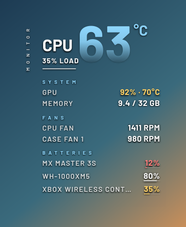
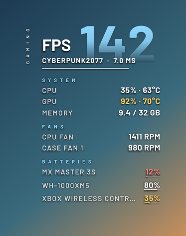

> 🌐 **[Prism Monitor Website — danny19862025.github.io/prism-monitor](https://danny19862025.github.io/prism-monitor/)**

# Prism Monitor

A quiet desktop widget for **Windows 10/11** and **Linux** that shows **game FPS**, **CPU and GPU temperature and load**, **memory**, **fan speeds** and **controller, keyboard and headset batteries**. It sits on your desktop or over your game, with a tray icon for its options. It only reads sensors and never changes fan speeds or clocks.

<p align="center">
  
  
</p>

## Download and install

### Windows 10 / 11

1. Download **`PrismMonitor-Setup-<version>.exe`** from the [latest release](https://github.com/danny19862025/prism-monitor/releases/latest).
2. Run it. It installs for your account only, with no administrator prompt (choose *all users* in the first dialog if you want that).
   The installer is not code-signed, so Windows SmartScreen may warn. Check the SHA-256 listed in the release, then choose **More info → Run anyway**.
3. Start **Prism Monitor** from the Start menu. The widget appears at the top right of your main screen, and a tray icon (four bars) appears in the notification area.
4. **CPU temperature, CPU power and motherboard fans** need a small sensor helper. Keep **Set up CPU sensors** ticked in the installer, or click the tray notification on first start. Windows asks for administrator approval once. After that the helper starts automatically, with no prompt.

Prefer no installer? Download **`PrismMonitor-windows.zip`** from the same release, extract it and run `PrismMonitor\PrismMonitor.exe`. Keep the folder together.

**Updating:** run the new installer over the old one. Your settings are kept. **Settings → About → Check for updates** tells you when a new version is out.

**Uninstalling:** **Settings → Apps → Installed apps → Prism Monitor → Uninstall**. Your settings stay in `%APPDATA%\PrismMonitor`.

### Linux

Tested on Arch Linux with KDE Plasma 6 (Wayland). No administrator rights are needed: all sensors come from the kernel.

**1. Install what it needs** (Python and git; a C compiler and Vulkan tools for game FPS). Pick your distribution:

```sh
# Arch, Manjaro, EndeavourOS, CachyOS
sudo pacman -S --needed git python gcc vulkan-icd-loader vulkan-tools
# Debian, Ubuntu, Linux Mint, Pop!_OS
sudo apt install git python3 python3-venv gcc libvulkan1 vulkan-tools
# Fedora, Nobara
sudo dnf install git python3 gcc vulkan-loader vulkan-tools
# openSUSE
sudo zypper install git python3 gcc libvulkan1 vulkan-tools
```

Game FPS also needs your GPU's Vulkan driver. On Arch, add `vulkan-radeon` (AMD), `vulkan-intel` (Intel) or `nvidia-utils` (NVIDIA); on Debian, Ubuntu and Fedora, AMD and Intel use `mesa-vulkan-drivers`. Full per-GPU commands are in the [guide](docs/GUIDE.md#installing-what-fps-needs).

**2. Download and install Prism Monitor:**

```sh
git clone https://github.com/danny19862025/prism-monitor.git
cd prism-monitor
./Install-Linux.sh
```

The installer sets up a Python environment in the folder, builds the game FPS layer, adds **Prism Monitor** to your app menu, turns on **Start when I sign in** and starts it. On KDE Plasma 6 and GNOME it also installs a desktop widget (see below). Running it again is safe.

**3. Turn on game FPS:** right-click the widget and switch on **Show FPS**. Games started after that are counted, including Windows games on Steam/Proton. No launch options are needed.

**Updating:**

```sh
cd prism-monitor
git pull
./Install-Linux.sh
```

**Desktop widget (KDE Plasma 6 and GNOME 45–49).** On KDE, right-click the desktop → **Add or Manage Widgets** → search **Prism Monitor** and drag it onto the desktop. On GNOME, sign out and back in once, and the widget appears behind your windows. Prism Monitor keeps running in the tray and feeds the widget. **Show widget** in the tray menu brings its own window back.

## Using it

- **Move** it by dragging. **Right-click** the widget or the tray icon for the menu. **Double-click** opens Settings.
- **Widget position:** *On top of windows* (see it over games), *Normal*, or *Behind windows* (on the desktop like a clock, under every window).
- **Looks:** *Poster* (no panel, bold Barlow lettering, a big faded number) or *Card* (a dark panel with history graphs). In Poster you can choose the size, a background panel and its opacity, the font, the text colour and the number colour.
- **Big number:** CPU or GPU temperature, replaced by FPS while you play.
- **Sections:** turn FPS, CPU / GPU / memory, fans and batteries on or off from the menu.
- **Themes:** Dark, Midnight, Light, or System (follows Windows light/dark mode).
- **Keep awake:** keep the PC awake for a while, until a download, render or app finishes, then optionally sleep or shut down. Like `caffeinate` on a Mac.
- **Click-through** lets clicks pass to the game underneath. Turn it off from the tray icon.

## What it reads

| | Windows | Linux |
|---|---|---|
| **CPU** | Load from Windows. Temperature, power and measured clocks from the sensor helper (LibreHardwareMonitor) | `/proc`, cpufreq, hwmon (`k10temp`, `coretemp`, `zenpower`), RAPL power |
| **GPU** | AMD driver (ADL): temperature, hotspot, load, clock, power, fan, VRAM | `amdgpu` driver files: temperature, power, clock, fan, load, VRAM |
| **Memory and swap** | Windows memory status and page file | `/proc/meminfo` (swap partitions, files and zram) |
| **Fans** | Motherboard fans through the sensor helper | Kernel hwmon fan inputs (needs a Super I/O driver such as `nct6775` or `it87`) |
| **Game FPS** | Bundled Intel PresentMon: DirectX, Vulkan and OpenGL games | A small Vulkan layer: Vulkan games, including Proton/DXVK |
| **Batteries** | PlayStation and Xbox controllers, Bluetooth keyboards, mice and headsets, laptop battery | UPower (controllers, BlueZ devices, Logitech, laptop battery) |

Everything stays on your PC. Prism Monitor sends nothing anywhere, except one request to GitHub when you click **Check for updates**.

The [guide](docs/GUIDE.md) covers every setting, the sensor helper, FPS details and troubleshooting.

## Build from source

**Windows** (Python 3.12–3.14 with the `py` launcher):

```bat
Run-PrismMonitor.cmd      :: set up and run from source
Build-Windows.cmd         :: test, then build dist\PrismMonitor-windows.zip
```

The installer `dist\PrismMonitor-Setup-<version>.exe` is built too when [Inno Setup 6](https://jrsoftware.org/isinfo.php) is installed (`winget install JRSoftware.InnoSetup`).

**Tests** (any platform):

```sh
QT_QPA_PLATFORM=offscreen .venv/bin/python -m unittest discover -s tests -v
```

## Support

Prism Monitor is free, with no ads or tracking. If it is useful to you, you can [buy me a coffee](https://buymeacoffee.com/danny1986). ☕

Licence: GPL-3.0. See [THIRD_PARTY_NOTICES.md](THIRD_PARTY_NOTICES.md) for bundled components.
