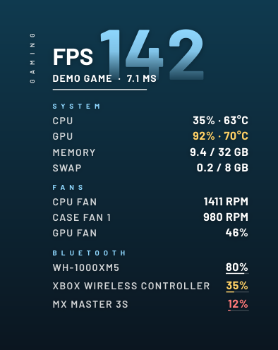

# Prism Monitor

A small always-on-top widget that shows **game FPS**, **CPU and GPU temperature and usage**, **memory**, **fan speeds** and **Bluetooth device battery**,
on **Windows 10/11** and **Linux**. It sits in a corner of the screen, with a tray icon for its options.



It is a separate companion app to [prism-light](https://github.com/danny19862025/prism-light), and it only reads sensors. It never changes fan speeds.

## What it reads, and from where

| | Windows | Linux |
|---|---|---|
| **Fans** | [LibreHardwareMonitor](https://github.com/LibreHardwareMonitor/LibreHardwareMonitor) while it is running (Windows has no built-in fan API), plus NVIDIA GPU fan % via `nvidia-smi` | Kernel `hwmon` (board chips, laptop EC drivers such as `hp`/`thinkpad`/`dell-smm`, AMD GPUs), plus `nvidia-smi` |
| **FPS** | Bundled Intel [PresentMon](https://github.com/GameTechDev/PresentMon): works for any DirectX/Vulkan/OpenGL game, and shows the game in the foreground | [MangoHud](https://github.com/flightlessmango/MangoHud) logging, for games started with `prism-monitor-run` |
| **CPU / GPU** | Usage from Windows. Temperatures from LibreHardwareMonitor, plus NVIDIA via `nvidia-smi` | `/proc/stat`, and temperatures from hwmon (`coretemp`, `k10temp`, `zenpower`, `amdgpu`, `nouveau`) plus `nvidia-smi`. Intel integrated graphics report no temperature, so they show no GPU row |
| **Memory** | Windows memory status | `/proc/meminfo`, plus a Swap row when swap is set up |
| **Bluetooth battery** | The same battery value that Settings › Bluetooth shows | BlueZ (`org.bluez.Battery1`), kernel HID batteries (Logitech, DualSense, Xbox via xpadneo…), and UPower as a fallback |

Sections with nothing to show are hidden. For example, FPS appears only while a game is running. To see why a section is empty, right-click the widget and turn on **Show tips for empty sections**.

## Windows

1. Download `PrismMonitor-windows.zip` from the latest build in the **Actions** tab, unzip it and run `PrismMonitor.exe`.
   To run it from source instead, use `Run-PrismMonitor.cmd`. It needs Python 3.12+ and sets itself up on first run.
2. **Fans:** install and run LibreHardwareMonitor **as administrator** (`winget install LibreHardwareMonitor.LibreHardwareMonitor`).
   In its Options menu, turn on *Run on Windows startup* and *Start minimized*. Prism Monitor picks its fans up automatically.
3. **FPS:** Windows only lets administrators, or members of *Performance Log Users*, watch frame events.
   Right-click the widget and choose **Allow FPS without admin…**, approve the prompt, then sign out and back in.
   (Starting Prism Monitor as administrator also works.)
4. Games need to run in **borderless/windowed** mode for the widget to be drawn above them. Exclusive fullscreen covers every other window.

## Linux

```sh
python build.py                         # or download PrismMonitor-linux.zip from Actions
dist/PrismMonitor/install-linux.sh      # installs to ~/.local, adds a menu entry
sudo pacman -S mangohud lib32-mangohud  # only needed for FPS
```

Running from source: `scripts/install-linux.sh` does the same thing using a `.venv` in this folder.

**FPS:** start each game through `prism-monitor-run`. For Steam games, open the game's Properties and set
**Launch options** to `prism-monitor-run %command%`. It turns on MangoHud logging, makes MangoHud's own HUD invisible (MangoHud stops logging if the HUD is switched off; set
`PRISM_MONITOR_HUD=1` to keep the HUD) and Prism Monitor reads the live log.

On a Wayland session the widget runs through XWayland, because Wayland doesn't let apps keep themselves on top or remember where their window was.

## Using the widget

- Drag the widget to move it. Right-click it, or the tray icon, for the menu.
- **Look:** *Poster* (the default) matches the Still desktop clock: no panel, bold Barlow lettering, a large faded light-blue number with a °C mark (CPU or GPU temperature, your choice; FPS while you play) and a vertical caption. *Card* is a compact dark panel. Poster comes in Small, Medium and Large.
- It's a widget, not an app window: it doesn't appear in the taskbar/dock or Alt+Tab, and on KDE Plasma it shows on every virtual desktop.
- **Stay on top of windows** (on by default, so you can see it over games). Turn it off to have it sit on the desktop behind your windows, like a clock widget.
- In the menu you can show or hide each section, lock its position, make it **click-through** (clicks pass to the game; turn it off again from the tray), change the background opacity, and start it at sign-in.
- `--demo` shows sample readings, `--print` prints one reading to the terminal, and `--smoke-test` checks that it starts.

## Development

```sh
python -m venv .venv && .venv/bin/pip install -r requirements-build.txt
QT_QPA_PLATFORM=offscreen .venv/bin/python -m unittest discover -s tests -v
.venv/bin/python main.py --demo
```

GitHub Actions builds and smoke-tests both the Windows and Linux portable ZIPs on every push.

MIT licensed. See [THIRD_PARTY_NOTICES.md](THIRD_PARTY_NOTICES.md).
